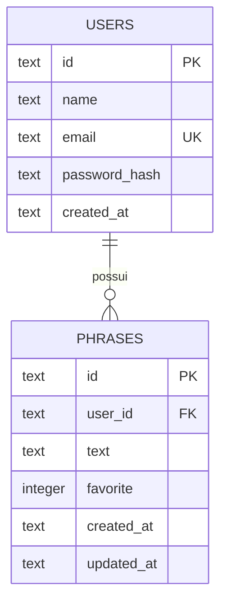

# Além da Voz — aplicativo mobile

Aplicativo acadêmico em **React Native + Expo**, com API em **Node.js + Express + SQLite**. A câmera, a letra reconhecida e a mensagem em formação ficam na mesma tela. A interface usa React Native Paper, navegação Stack + Tabs e linguagem em português.

## Comece aqui

Este pacote contém **código-fonte**, não um APK pronto. Extraia o ZIP antes de executar. Não substitua o `app.js` do seu site por estes arquivos: o aplicativo é um projeto separado.

1. Instale Node.js **22.13 ou superior** no computador (preferencialmente uma versão LTS). No Windows, se o PowerShell bloquear o `npm`, use `npm.cmd` (por exemplo, `npm.cmd run setup`).
2. Abra um terminal na pasta que contém este README e execute `npm run setup`. Esse comando instala as dependências, gera um segredo local para a API e configura um IP sugerido do computador. Ele não sobrescreve arquivos `.env` existentes.
3. Nesse terminal, execute `npm run api` e deixe-o aberto.
4. Em outro terminal, na mesma pasta, execute `npm run mobile`.
5. Conecte celular e computador à mesma rede Wi-Fi. Abra o projeto em um cliente Expo compatível com **SDK 58** e leia o QR Code do terminal.
6. No app, abra **Meus sinais → Cadastrar sinal**, permita a câmera, capture uma pose e salve o nome. Ou use **Importar JSON** para carregar seus sinais da versão web.
7. Em **Ajustes → Gesto de confirmação**, cadastre uma pose diferente das letras.
8. Em **Conversar**, ative a câmera, mantenha o sinal até a barra completar, confira a letra e faça o gesto de confirmação. Solte o gesto antes da próxima letra.

O Expo Go distribuído nas lojas muda de SDK com o tempo. Se ele não aceitar SDK 58, use um cliente compatível disponível em https://expo.dev/go (quando disponível para seu sistema) ou gere um development build conforme `docs/INSTALACAO.md`. Em iPhone físico, versões antigas do Expo Go podem não estar disponíveis: um development build pode exigir conta Apple e assinatura. Não atualize apenas a versão de `expo` no package.json sem atualizar os pacotes compatíveis.

**Sem login:** câmera, cadastro/importação/exportação de sinais e mensagem local. **Com login:** CRUD de frases por usuário, armazenadas na API. A API precisa estar ligada para login e frases; o reconhecimento não envia imagens a ela.

## Problema

Pessoas podem precisar de um recurso visual para compor mensagens a partir de poses de mão, sem alternar constantemente entre a câmera e outra tela. Uma interface que esconde o resultado ou exige um toque a cada reconhecimento interrompe a interação.

## Solução

O Além da Voz reúne câmera, resultado e mensagem numa área contínua. A letra só muda após estabilização. Um gesto cadastrado confirma e adiciona a letra; manter esse gesto não duplica o texto. Há pausa, espaço, apagar, limpar com confirmação, copiar e salvar frases. O usuário pode cadastrar tantas capturas quanto precisar, dentro dos limites de armazenamento definidos.

**Escopo real:** protótipo experimental de comparação de poses **estáticas de uma mão**. Não traduz Libras completa, movimentos, gramática, expressões faciais ou sinais de duas mãos. Não inclui um alfabeto universal treinado. É necessário cadastrar/importar referências e testar com cada participante. Nomes de sinais são definidos pelo usuário e devem ser validados com alguém fluente em Libras.

## Justificativa pessoal (sugestão para o grupo revisar)

Como estudante e profissional interessada em UX/UI, quero explorar interfaces que facilitem a comunicação visual e deem retorno claro durante a interação. Este projeto permite aplicar conhecimentos de acessibilidade, organização de telas e desenvolvimento mobile a um problema concreto. Sua utilidade precisa ser avaliada com usuários, especialmente pessoas surdas e fluentes em Libras, sem pressupor que um protótipo substitua a comunicação em Libras.

## Decisões de UX

- Câmera e letra permanecem juntas; a mensagem fica imediatamente abaixo. Em telas pequenas ou com fontes grandes, o conteúdo pode rolar, sem cortar controles.
- A câmera só é ativada por ação do usuário; desliga ao sair da tela, pausar ou colocar o app em segundo plano.
- Tempo padrão de 1,3 s por letra e 0,9 s para confirmar; opção de 2 s e 1,3 s. O processamento exige ao menos três observações e pode levar mais tempo em aparelhos lentos. O intervalo máximo entre quadros (mínimo 1,8 s) se ajusta à velocidade medida do aparelho, para que celulares lentos ainda consigam completar o sinal.
- Barra de progresso, instrução textual e vibração opcional; informação não depende apenas de cor ou som.
- Cadastro separado da conversa, com captura individual, prévia da imagem e opção de continuar cadastrando.
- Estados vazios explicam a próxima ação. Erros de permissão, conexão e carregamento têm orientações e opção de tentar novamente.
- Mensagem editável, exclusão com confirmação e exportação dos sinais.
- Dados de sinais e mensagem são do **aparelho**, compartilhados entre sessões locais. As frases na API são separadas por conta.

## Estrutura

```text
app/
  mobile/
    App.js
    src/
      components/    # câmera, UI reutilizável
      context/       # sessão, preferências, sinais, texto
      hooks/         # useRemote
      recognition/   # normalização, classificação e estabilização
      screens/       # telas
      services/      # cliente HTTP, armazenamento dos sinais em arquivo
    tests/
  api/
    src/
      controllers/
      routes/
      services/
      middleware/
    tests/
docs/
scripts/setup.cjs
```

O enunciado cita `mobile` e `api` e também pede código em `/app`. Por isso ambos estão em **`/app/mobile` e `/app/api`**, no mesmo repositório.

## Requisitos da disciplina

| Requisito                         | Implementação                                                                  |
| --------------------------------- | ------------------------------------------------------------------------------ |
| Stack + Tab e parâmetros          | `App.js`; `SignalDetail` recebe `name`, `PhraseEdit` recebe `id` ou `text`     |
| Login em API Node.js + token      | `/auth/register`, `/auth/login`, `/auth/me`; JWT em SecureStore, header Bearer |
| Context API                       | `src/context/AppContext.js`                                                    |
| API externa, loading e erro       | `LearnScreen` consulta MediaWiki/Wikipédia; retry e timeout                    |
| FlatList + keyExtractor + detalhe | Meus sinais e Minhas frases                                                    |
| Formulário controlado             | Cadastro de sinal e edição de frase: TextInput, Switch, Button, validação      |
| AsyncStorage                      | Mensagem, URL da API e preferências (sinais ficam em arquivo; ver abaixo)      |
| Hook customizado                  | `useRemote`, `useApp`                                                          |
| React Native Paper + StyleSheet   | Componentes e telas nativos, tema roxo claro                                   |
| Recurso do dispositivo            | Câmera e vibração                                                              |
| CRUD na API                       | `/phrases` e `/phrases/:id`, integrado às telas Frases/Salvar frase            |
| Pastas organizadas                | mobile e API separados, com controllers/routes/services na API                 |

## DER / dados da API



Senha armazenada com scrypt e salt aleatório. JWT com validade de 7 dias, issuer e audience verificados. Todas as operações de frases filtram pelo usuário autenticado. Os sinais ficam no aparelho, no arquivo `alem-sinais.json` (pasta de documentos do app, via `expo-file-system`); não pertencem ao banco da API. Eles não usam o AsyncStorage porque, no Android, valores acima de cerca de 2 MB podem não ser lidos de volta. A gravação passa por um arquivo temporário. Se a leitura falhar ao abrir o app, os dados guardados não são sobrescritos: o arquivo ilegível é mantido como cópia (`alem-sinais-ilegivel-*.json`). Dados da versão anterior (chave `alem-mobile-v1`) são migrados automaticamente na primeira abertura. O arquivo SQLite é persistido em `app/api/data/alem.db` e deve ficar em volume persistente quando a API for hospedada.

## API

| Método             | Endpoint         | Autenticação | Uso                                  |
| ------------------ | ---------------- | ------------ | ------------------------------------ |
| GET                | `/health`        | Não          | Testar conexão no aplicativo         |
| POST               | `/auth/register` | Não          | `{name,email,password}`              |
| POST               | `/auth/login`    | Não          | `{email,password}`                   |
| GET                | `/auth/me`       | Bearer       | Dados públicos da conta              |
| GET / POST         | `/phrases`       | Bearer       | Listar / criar `{text,favorite}`     |
| GET / PUT / DELETE | `/phrases/:id`   | Bearer       | Ler / editar / excluir frase própria |

`favorite` deve ser booleano. Mensagens limitadas a 1.000 caracteres. E-mail único, senha de 8 a 128 caracteres. Em produção, configure HTTPS e um segredo forte; não envie `.env` ou o banco ao GitHub.

## Como funciona o reconhecimento

A `CameraView` do Expo exibe a câmera nativa. Fotos temporárias são reduzidas a 480 px de largura e processadas sequencialmente por MediaPipe em uma WebView interna sem interface. Ela **não solicita acesso à câmera**: recebe somente a imagem capturada pelo componente nativo. O detector devolve 21 pontos da mão, normalizados em 63 coordenadas. As imagens temporárias são removidas do cache após cada ciclo e não são enviadas à API.

O modelo e o runtime são carregados de Google Storage e jsDelivr. Internet é necessária para inicializar; funcionamento offline do modelo não é garantido. A WebView processa em modo IMAGE/CPU para compatibilidade, então a frequência depende do celular e é inferior à de um pipeline nativo de vídeo. Esta é uma implementação acadêmica de reconhecimento contínuo por capturas, não uma promessa de detecção em todos os aparelhos.

Comparação: referência mais próxima, normalização de posição/escala, tolerância a rotação e espelhamento horizontal. Limite padrão de distância 0,38; modo mais tolerante 0,50, com maior possibilidade de confusão. Confirmação permanece estrita (0,18 e margem 0,035 em relação às letras). A barra mostra **tempo de estabilização**, não probabilidade de acerto.

A importação aceita JSON da versão web `{version:1, classes:[{name,samples}]}`. A exportação mobile inclui `confirmation` opcional. São aceitos até 30 sinais, 2.000 amostras por sinal, nomes de até 40 caracteres e arquivos de até 20 MB. Uma amostra tem 63 números finitos. Capturas existentes no navegador não são copiadas automaticamente para o celular: exporte e importe o arquivo.

## Testes e limites da validação

Execute `npm test` na raiz. Há testes de autenticação, CRUD, autorização entre usuários, entrada inválida e reconhecimento (normalização, espelhamento, temporização, transições e bloqueio de duplicação).

Execute `npm --prefix app/mobile run check` para gerar bundles Android/iOS. Isso valida o empacotamento JavaScript, **não gera APK/IPA nem substitui teste em celular**.

Veja `docs/VALIDACAO.md` para os resultados e o roteiro obrigatório de teste físico. Não foram medidas precisão com diferentes pessoas, taxa de quadros, desempenho térmico ou compatibilidade da câmera em aparelhos reais neste ambiente.

## GitHub e entrega

Crie um repositório separado para o aplicativo, mantendo o site web atual. Na raiz extraída:

```bash
git init -b main
git add .
git commit -m "chore: adiciona base do projeto mobile e API"
git switch -c feat/validacao-mobile
```

Adicione o remote do repositório que você criar e envie os commits. Faça novas alterações na branch de feature, teste e integre na `main`. Se o repositório for privado, o enunciado pede convite para **leofmds**; esse convite deve ser feito pelo grupo. Este pacote não foi publicado automaticamente no seu GitHub.

## Referências técnicas

- Expo Camera SDK 58: https://docs.expo.dev/versions/v58.0.0/sdk/camera/
- Expo WebView: https://docs.expo.dev/versions/v58.0.0/sdk/webview/
- MediaPipe Hand Landmarker: https://ai.google.dev/edge/mediapipe/solutions/vision/hand_landmarker/web_js
- React Navigation: https://reactnavigation.org/docs/getting-started/
- MediaWiki API: https://www.mediawiki.org/wiki/API:Main_page
