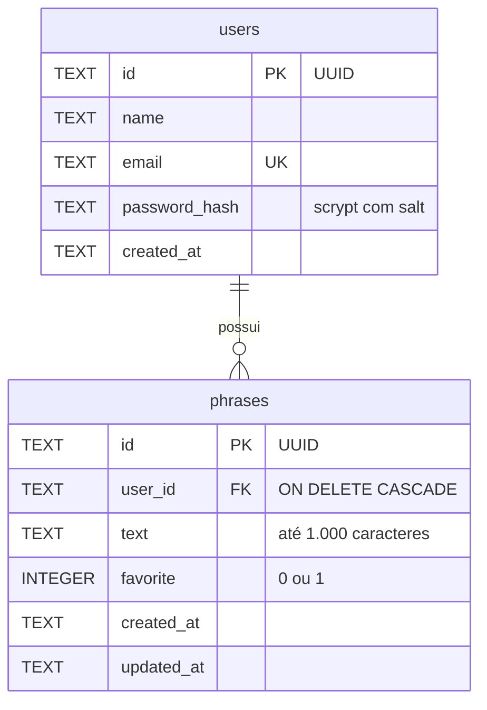
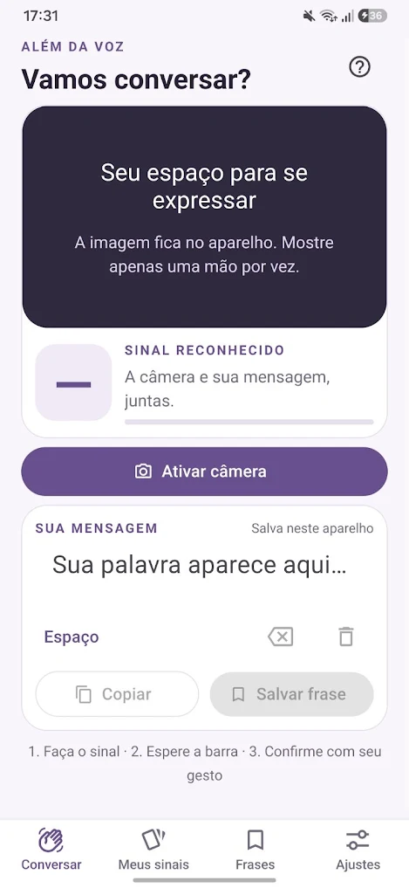
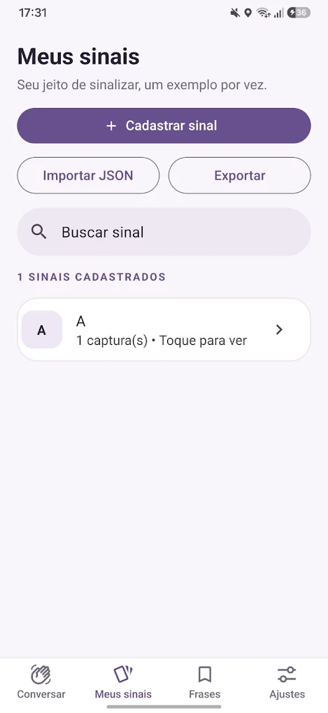
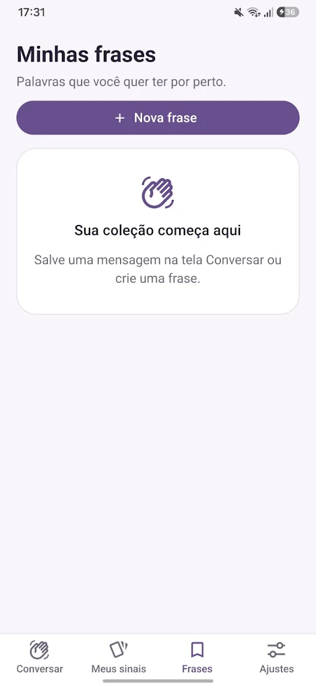
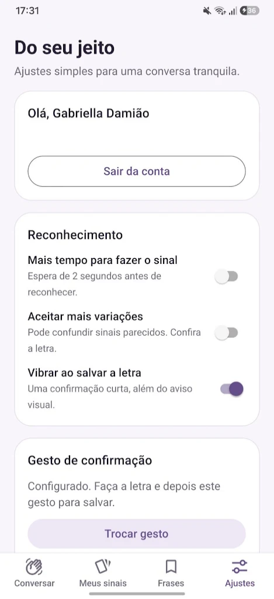

# Além da Voz

Aplicativo mobile para compor mensagens a partir de poses de mão. A câmera, a letra reconhecida e a mensagem em formação ficam na mesma tela: o usuário mantém o sinal, confere a letra e faz um gesto de confirmação para adicioná-la ao texto, sem precisar tocar na tela a cada letra. Os sinais são cadastrados pelo próprio usuário (ou importados da versão web), e as frases mais usadas podem ser salvas na conta.

O repositório contém o aplicativo React Native com Expo (`/app/mobile`), a API REST própria em Node.js (`/app/api`) e a documentação do projeto (`/docs`).

**Escopo:** protótipo acadêmico de reconhecimento de poses **estáticas de uma mão**. Não traduz a Libras completa (movimentos, gramática, expressões faciais e sinais de duas mãos) e não vem com um alfabeto pré-treinado.

## Sumário

1. [Problema](#problema)
2. [Como o Além da Voz resolve o problema](#como-o-além-da-voz-resolve-o-problema)
3. [Justificativa pessoal](#justificativa-pessoal)
4. [Funcionalidades](#funcionalidades)
5. [Tecnologias](#tecnologias)
6. [Estrutura do projeto](#estrutura-do-projeto)
7. [Pré-requisitos](#pré-requisitos)
8. [Instalação rápida](#instalação-rápida)
9. [API: instalação e execução](#api-instalação-e-execução)
10. [Aplicativo: instalação e execução](#aplicativo-instalação-e-execução)
11. [Variáveis de ambiente](#variáveis-de-ambiente)
12. [Banco de dados](#banco-de-dados)
13. [Testes](#testes)
14. [Endpoints](#endpoints)
15. [DER do banco de dados](#der-do-banco-de-dados)
16. [Telas](#telas)
17. [Como funciona o reconhecimento](#como-funciona-o-reconhecimento)
18. [Mapa dos requisitos acadêmicos](#mapa-dos-requisitos-acadêmicos)
19. [Decisões técnicas](#decisões-técnicas)
20. [Limitações conhecidas](#limitações-conhecidas)
21. [Integrantes](#integrantes)

## Problema

Pessoas que se comunicam por sinais, ou que precisam de um apoio visual para escrever, encontram poucas ferramentas que transformem poses de mão em texto de forma contínua. As soluções existentes costumam separar a câmera do resultado, exigir um toque a cada letra reconhecida ou esconder o que foi entendido, o que interrompe a interação e gera erros que só aparecem no fim da mensagem.

## Como o Além da Voz resolve o problema

- Reúne câmera, letra reconhecida e mensagem em uma área contínua, sem alternar entre telas.
- A letra só muda depois de estabilizar: uma barra de progresso mostra quanto falta para o sinal ser aceito.
- Um gesto de confirmação cadastrado pelo usuário adiciona a letra ao texto, sem toque na tela. Manter o gesto não duplica a letra.
- Cada pessoa cadastra os próprios sinais, com quantas capturas precisar, ou importa os sinais da versão web.
- A mensagem pode ser editada, copiada e salva como frase na conta do usuário, para reutilizar depois.
- As imagens da câmera são processadas no aparelho e não são enviadas à API.

## Justificativa pessoal

> **Proposta editável — revisar e reescrever com as experiências reais do grupo antes da entrega.**
>
> Como estudante e profissional interessada em UX/UI, quero explorar interfaces que facilitem a comunicação visual e deem retorno claro durante a interação. O Além da Voz permite aplicar, em um problema concreto, conhecimentos de acessibilidade, organização de telas e desenvolvimento mobile integrado a uma API própria. Sua utilidade precisa ser avaliada com usuários, especialmente pessoas surdas e fluentes em Libras, sem pressupor que um protótipo substitua a comunicação em Libras.

## Funcionalidades

| Área | O que faz |
| --- | --- |
| Conversa | Câmera ativada pelo usuário, letra reconhecida em destaque, barra de estabilização, confirmação por gesto, espaço, apagar, limpar com confirmação, copiar e salvar a mensagem como frase. |
| Meus sinais | Cadastro de sinais com prévia da captura, várias capturas por sinal, busca que ignora acentos e maiúsculas, detalhes do sinal, exclusão com confirmação. |
| Importar e exportar | Importa o JSON da versão web (`{version:1, classes:[{name,samples}]}`) e exporta um backup, incluindo o gesto de confirmação. |
| Ajustes | Tempo por letra (1,3 s ou 2 s), modo mais tolerante, vibração, gesto de confirmação, endereço da API com teste de conexão. |
| Autenticação | Cadastro, login e logout na API própria; sessão restaurada ao abrir o app. |
| Minhas frases | CRUD de frases por usuário (criar, listar, ver, editar, favoritar e excluir), com estados de carregamento, erro e lista vazia. |
| Conhecer a Libras | Textos introdutórios da Wikipédia em português, com carregamento, erro e nova tentativa. |
| Como usar | Guia passo a passo do fluxo de cadastro e conversa. |
| Feedback | Mensagens de sucesso e erro em Snackbar, vibração opcional e instruções em texto (nada depende só de cor ou som). |

## Tecnologias

**Aplicativo (`/app/mobile`)**: Expo SDK 58, React Native 0.88, React 19, JavaScript, React Navigation 7 (Native Stack + Bottom Tabs), React Native Paper 5, Context API, AsyncStorage, Expo SecureStore, Expo Camera, Expo Image Manipulator, Expo File System, React Native WebView, MediaPipe Hand Landmarker (via WebView), Expo Clipboard, Expo Document Picker e Expo Sharing.

**API (`/app/api`)**: Node.js 22.13+, Express 5, SQLite nativo do Node (`node:sqlite`), JWT (`jsonwebtoken`), senhas com scrypt (`node:crypto`), Helmet, CORS e express-rate-limit.

**Ferramentas**: Git, EAS Build (APK Android), Node Test Runner (`node --test`).

## Estrutura do projeto

```
alem-da-voz-mobile/
├── app/
│   ├── mobile/                      Aplicativo React Native (Expo)
│   │   ├── App.js                   Providers (SafeArea, Paper, AppProvider) e navegação Stack + Tabs
│   │   ├── app.json                 Configuração do Expo, permissões e plugins
│   │   ├── eas.json                 Perfis de build (APK de teste)
│   │   ├── tests/                   Testes do reconhecimento
│   │   └── src/
│   │       ├── components/          CameraSurface (câmera + detector) e componentes de UI
│   │       ├── context/             AppContext: sessão, preferências, sinais e mensagem
│   │       ├── hooks/               useRemote (carregamento, erro e nova tentativa)
│   │       ├── recognition/         Normalização, classificação e estabilização das poses
│   │       ├── screens/             Conversa, sinais, cadastro, frases, login, ajustes, ajuda
│   │       └── services/            Cliente HTTP da API e armazenamento dos sinais em arquivo
│   └── api/                         API REST (Express)
│       ├── src/
│       │   ├── controllers/         authController e phraseController
│       │   ├── middleware/          Autenticação por token
│       │   ├── routes/              Rotas da API
│       │   ├── services/            Banco, senhas e token, validação de frases
│       │   ├── app.js               Montagem do Express
│       │   └── server.js            Inicialização
│       └── tests/                   Testes de integração HTTP
├── docs/                            Instalação e validação
├── scripts/setup.cjs                Instala dependências e cria os arquivos .env
└── README.md
```

## Pré-requisitos

- Node.js 22.13 ou superior e npm (a API usa o SQLite nativo do Node).
- Celular Android ou iPhone na mesma rede Wi-Fi do computador.
- Expo Go compatível com o SDK 58, um development build ou o APK gerado pelo EAS.

## Instalação rápida

Na raiz do repositório:

```bash
npm run setup     # instala as dependências, gera o JWT_SECRET e sugere o IP do Wi-Fi
npm run api       # terminal 1: inicia a API na porta 3000
npm run mobile    # terminal 2: inicia o Expo e mostra o QR Code
```

O `setup` não sobrescreve arquivos `.env` existentes. No Windows, se o PowerShell bloquear o `npm`, use `npm.cmd`.

**Atalhos para Windows** (usam o Node 24 instalado pelo nvm-windows, sem trocar o Node padrão do computador):

| Script | O que faz |
| --- | --- |
| `iniciar-api.ps1` | Inicia a API |
| `testar.ps1` | Roda os testes |
| `entrar-expo.ps1` | Entra na conta Expo |
| `gerar-apk.ps1` | Gera um novo APK no EAS |

Execute com `powershell -ExecutionPolicy Bypass -File .\iniciar-api.ps1` (troque o nome do script).

## API: instalação e execução

```bash
cd app/api
npm install
cp .env.example .env            # no Windows (PowerShell): Copy-Item .env.example .env
```

Edite `.env` e defina um `JWT_SECRET` aleatório com pelo menos 32 caracteres. Para gerar um:

```bash
node -e "console.log(require('crypto').randomBytes(48).toString('hex'))"
```

Inicie a API:

```bash
npm start         # produção
npm run dev       # desenvolvimento com recarga automática
```

- API: `http://localhost:3000`
- Health check: `http://localhost:3000/health`

A API escuta em `0.0.0.0`, então o celular acessa pelo IP do computador na rede local. Se o celular não conseguir conectar, libere a porta 3000 no firewall do computador.

## Aplicativo: instalação e execução

```bash
cd app/mobile
npm install
cp .env.example .env            # defina EXPO_PUBLIC_API_URL com o IP do computador
npx expo start
```

Leia o QR Code com um cliente Expo compatível com o SDK 58. Celular e computador devem estar na mesma rede Wi-Fi.

### Endereço da API no celular

`localhost` dentro do celular aponta para o próprio aparelho, não para o computador. Use o IP do computador na rede local, por exemplo `http://192.168.0.10:3000`. O endereço pode ser alterado a qualquer momento em **Ajustes → Conexão com o servidor**, com o botão **Testar e salvar conexão** (que chama `/health`).

### APK (Android)

```bash
cd app/mobile
npx eas-cli build --platform android --profile preview
```

O perfil `preview` gera um APK para instalação direta. O plugin `expo-build-properties` libera `http://` no Android para que o APK consiga acessar a API rodando no computador durante testes e apresentação. O endereço gravado no build vem de `EXPO_PUBLIC_API_URL` no perfil `preview` do `eas.json` e pode ser trocado em Ajustes depois de instalado.

## Variáveis de ambiente

### API (`app/api/.env`)

| Variável | Obrigatória | Padrão | Descrição |
| --- | --- | --- | --- |
| `PORT` | não | `3000` | Porta HTTP. |
| `DB_PATH` | não | `./data/alem.db` | Caminho do arquivo SQLite. |
| `JWT_SECRET` | sim | — | Segredo do JWT, mínimo de 32 caracteres. |

### App (`app/mobile/.env`)

| Variável | Descrição |
| --- | --- |
| `EXPO_PUBLIC_API_URL` | URL base da API, ex.: `http://192.168.0.10:3000`. Opcional: também pode ser definida em Ajustes. |

Arquivos `.env` reais e o banco não são versionados. Apenas os `.env.example` entram no Git.

## Banco de dados

- Banco: SQLite, pelo módulo nativo `node:sqlite`, com `foreign_keys` e modo WAL ativados.
- As tabelas são criadas automaticamente na primeira execução (`app/api/src/services/database.js`).
- O arquivo fica em `app/api/data/alem.db` e deve estar em um volume persistente se a API for hospedada.
- Os sinais cadastrados **não** ficam no banco: são dados do aparelho, salvos no arquivo `alem-sinais.json` pelo `expo-file-system`.

## Testes

```bash
npm test                          # na raiz: API + reconhecimento
npm --prefix app/mobile run check # gera os bundles Android e iOS (valida o empacotamento)
```

Na API, o teste de integração sobe o Express com um banco em memória e cobre: cadastro, login, `/auth/me`, token adulterado, credenciais inválidas, criação, listagem, leitura, edição e exclusão de frases, entrada inválida e **isolamento entre usuários** (uma conta não lê, edita nem exclui frases de outra).

No app, os testes do reconhecimento cobrem: normalização de posição e escala, tolerância a espelhamento, rejeição de pose fora do limite, importação inválida, espera por letra e por confirmação, troca de sinal reiniciando a espera, gesto mantido sem duplicar letras e aparelho lento (um quadro a cada 2,2 s) ainda reconhecendo.

### Resultado da última execução

| Verificação | Resultado |
| --- | --- |
| API — `node --test` | 1 teste de integração passando (fluxo completo de autenticação e CRUD) |
| App — `node --test` (reconhecimento) | 5 testes passando |
| App — configuração do build Android | `usesCleartextTraffic="true"` confirmado no AndroidManifest gerado |
| APK via EAS (`preview`) | build concluído e instalado em celular Android |
| Celular → API na rede local | `Testar e salvar conexão` retornou "Conexão com a API verificada" |

O roteiro completo de teste no celular está em [`docs/VALIDACAO.md`](docs/VALIDACAO.md).

## Endpoints

Rotas marcadas com 🔒 exigem `Authorization: Bearer <token>`.

| Método | Rota | Descrição |
| --- | --- | --- |
| GET | `/health` | Verificação de disponibilidade (usada pelo teste de conexão do app) |
| POST | `/auth/register` | Cria conta `{ name, email, password }` e retorna `{ token, user }` |
| POST | `/auth/login` | Autentica `{ email, password }` e retorna `{ token, user }` |
| GET | `/auth/me` 🔒 | Dados públicos do usuário autenticado |
| GET | `/phrases` 🔒 | Lista as frases do usuário, das mais recentes para as mais antigas |
| POST | `/phrases` 🔒 | Cria frase `{ text, favorite }` |
| GET | `/phrases/:id` 🔒 | Detalhes de uma frase própria |
| PUT | `/phrases/:id` 🔒 | Edita texto e favorito |
| DELETE | `/phrases/:id` 🔒 | Exclui a frase |

Regras de validação: nome de 2 a 80 caracteres, e-mail único, senha de 8 a 128 caracteres, frase de até 1.000 caracteres e `favorite` booleano. Erros seguem o formato `{ "message": "..." }`. Rotas inexistentes respondem 404, e cadastro/login têm limite de 30 tentativas a cada 15 minutos por IP.

## DER do banco de dados



| Tabela | Campo | Tipo | Regra |
| --- | --- | --- | --- |
| users | id | TEXT | Chave primária (UUID) |
| users | name | TEXT | Obrigatório |
| users | email | TEXT | Obrigatório e único |
| users | password_hash | TEXT | `salt:hash` gerado com scrypt |
| users | created_at | TEXT | Data ISO |
| phrases | id | TEXT | Chave primária (UUID) |
| phrases | user_id | TEXT | Chave estrangeira para `users.id`, exclusão em cascata |
| phrases | text | TEXT | Obrigatório |
| phrases | favorite | INTEGER | 0 ou 1, padrão 0 |
| phrases | created_at / updated_at | TEXT | Datas ISO |

Todas as consultas de frases filtram pelo `user_id` do token, então cada usuário só acessa as próprias frases.

## Telas

Capturas do APK instalado em um celular Android.

| | | | |
| --- | --- | --- | --- |
|  |  |  |  |
| Conversar: câmera, sinal reconhecido e mensagem | Meus sinais: cadastro, importação e lista | Frases: estado vazio com convite | Ajustes: conta, reconhecimento e gesto de confirmação |

| Tela | Onde | O que mostra |
| --- | --- | --- |
| Conversar | Aba | Câmera, letra reconhecida, barra de estabilização e mensagem em formação |
| Meus sinais | Aba | Lista (FlatList) dos sinais cadastrados, busca, importar e exportar |
| Detalhes do sinal | Stack (recebe `name`) | Capturas do sinal e exclusão |
| Cadastrar | Stack (recebe `kind`) | Captura com prévia, nome do sinal e opção de continuar cadastrando |
| Frases | Aba | Lista (FlatList) das frases salvas na conta |
| Editar frase | Stack (recebe `id` ou `text`) | Formulário com texto, favorito (Switch) e validação |
| Ajustes | Aba | Conta, reconhecimento, gesto de confirmação, conexão com a API |
| Sua conta | Stack | Login e cadastro |
| Como usar | Stack | Guia de uso |
| Conhecer a Libras | Stack | Conteúdo da Wikipédia com carregamento e erro |

## Como funciona o reconhecimento

1. A `CameraView` do Expo exibe a câmera nativa. O app tira fotos temporárias, reduz para 480 px de largura e envia uma por vez a uma WebView interna, sem interface.
2. Na WebView, o MediaPipe Hand Landmarker encontra 21 pontos da mão (63 coordenadas). A WebView **não** acessa a câmera: recebe só a imagem capturada.
3. Os pontos são normalizados (posição e escala) e comparados com as referências cadastradas, com tolerância a rotação e espelhamento. Limite padrão de distância 0,38; modo tolerante 0,50.
4. A letra só é aceita depois de estabilizar por pelo menos três observações e pelo tempo escolhido (1,3 s ou 2 s). A confirmação usa um limite mais estrito (0,18).
5. As imagens temporárias são apagadas do cache após cada ciclo e nunca vão para a API.

O modelo e o runtime do MediaPipe são carregados da internet (jsDelivr e Google Storage) ao ativar a câmera.

## Mapa dos requisitos acadêmicos

| Requisito | Onde está |
| --- | --- |
| App React Native com Expo | `app/mobile/` (Expo SDK 58) |
| API própria em Node.js | `app/api/` (Express 5) |
| Stack + Bottom Tabs | `app/mobile/App.js` (abas Conversar, Meus sinais, Frases e Ajustes) |
| Tela recebendo parâmetros | `SignalDetail` (`name`), `PhraseEdit` (`id` ou `text`), `Capture` (`kind`) |
| Login integrado à API + token | `src/context/AppContext.js`, `src/screens/AuthScreen.js`, `app/api/src/controllers/authController.js` |
| Token guardado e enviado no header | Expo SecureStore em `AppContext.js`; header `Authorization: Bearer` em `src/services/api.js` |
| Context API | `src/context/AppContext.js` (sessão, preferências, sinais e mensagem) |
| API externa com loading e erro | Tela Conhecer a Libras (`src/screens/HelpScreen.js`), API da Wikipédia com timeout e nova tentativa |
| FlatList com keyExtractor + detalhes | `src/screens/SignalsScreen.js`, `src/screens/PhrasesScreen.js` |
| Formulário com TextInput, Switch e Button + validação | `src/screens/CaptureScreen.js`, `PhraseEditScreen` em `PhrasesScreen.js`, `AuthScreen.js` |
| AsyncStorage | Mensagem, endereço da API e preferências (`AppContext.js`) |
| Hook customizado | `src/hooks/useRemote.js`, `useApp` |
| React Native Paper + StyleSheet | Todas as telas e componentes |
| Pastas screens, components, hooks, services, context | `app/mobile/src/` |
| Recurso de dispositivo | Câmera (`src/components/CameraSurface.js`) e vibração |
| CRUD na API | `/phrases` e `/phrases/:id` |
| Endpoint próprio consumido no app | `/health`, `/auth/*` e `/phrases` |
| API com controllers, routes e services | `app/api/src/` |
| DER | Seção acima |
| Testes | `app/api/tests/`, `app/mobile/tests/` |

## Decisões técnicas

- **Token**: JWT com validade de 7 dias, `issuer` e `audience` verificados. No app, a sessão fica no **Expo SecureStore** e o token é enviado no header `Authorization`.
- **Senhas**: scrypt com salt aleatório e comparação em tempo constante (`timingSafeEqual`).
- **Sinais no aparelho**: os sinais podem passar de 2 MB, limite em que o AsyncStorage do Android pode falhar na leitura. Por isso ficam em arquivo (`alem-sinais.json`), com gravação por arquivo temporário. Se o arquivo não puder ser lido, ele é preservado como cópia (`alem-sinais-ilegivel-*.json`) e nada é sobrescrito.
- **Reconhecimento por capturas**: MediaPipe em modo IMAGE/CPU dentro de uma WebView, para funcionar no Expo sem módulo nativo extra. O intervalo entre quadros se ajusta à velocidade medida do aparelho, para celulares lentos ainda completarem o sinal.
- **Câmera sob controle do usuário**: só liga por ação do usuário e desliga ao sair da tela, pausar ou colocar o app em segundo plano.
- **Acessibilidade**: barra de progresso, instrução em texto e vibração opcional; a informação não depende só de cor ou som. Em telas pequenas ou com fonte ampliada, o conteúdo rola sem cortar controles.
- **Segurança da API**: Helmet, CORS, `express.json` limitado a 32 kB, rate limit no cadastro e login, consultas sempre filtradas pelo `user_id` do token e erros 500 sem detalhes internos.
- **Rede local no APK**: `usesCleartextTraffic` liberado via `expo-build-properties` para acessar a API em `http://` durante testes. Para uso real, a API deve ser hospedada com HTTPS.

## Limitações conhecidas

- **Escopo do reconhecimento**: apenas poses estáticas de uma mão. Não reconhece movimentos, sinais de duas mãos nem expressões faciais, e não substitui a comunicação em Libras.
- **Sem alfabeto pronto**: é preciso cadastrar ou importar as referências, e o reconhecimento funciona melhor com capturas da própria pessoa que vai usar.
- **Precisão não medida**: não foram feitos testes de precisão com diferentes pessoas, iluminações ou aparelhos. Os nomes dos sinais devem ser validados com alguém fluente em Libras.
- **Depende de internet ao iniciar**: o modelo do MediaPipe é baixado ao ativar a câmera; o funcionamento offline não é garantido.
- **Desempenho**: o processamento por fotos em WebView é mais lento que um pipeline nativo de vídeo e pode demorar em celulares mais simples.
- **API na rede local**: sem hospedagem, login e frases só funcionam com o computador ligado, a API rodando e o celular no mesmo Wi-Fi.

## Integrantes

- Gabriella Daniele
- Glauco Henrique
- Antonio Vinicius
